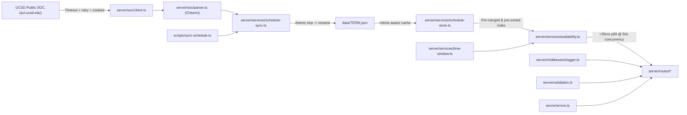

# EmptyBoard

**Real-time classroom availability engine for UC San Diego**, powered by UCSD's public [Schedule of Classes](https://act.ucsd.edu/scheduleOfClasses/scheduleOfClassesStudent.htm). Built with TypeScript, Node.js, Hono, and Cheerio (3 runtime dependencies, zero LLM calls on the hot path), EmptyBoard parses live quarter schedules across all 12 UCSD course levels into an in-memory per-room index that serves open-room discovery in **sub-200ms p99** even at 50x concurrency across **10,000+ sections**.

---

## Architecture



### Module Map

| Module | Responsibility |
|---|---|
| `server/index.ts` | Process entrypoint: loads config, starts `@hono/node-server`, handles `SIGINT`/`SIGTERM` graceful shutdown. |
| `server/app.ts` | Side-effect-free `createApp()` factory wiring logger, CORS, global `onError` + API `404` envelope, and routes. |
| `server/config.ts` | Typed environment and path configuration (`PORT`, daily window bounds, SOC timeouts/retries, cache TTL, log level). |
| `server/types/schedule.ts` | Strict domain & API types (`DayCode`, `Interval`, `SectionRow`, `Meeting`, `RoomAvailabilityIndex`) and canonical `roomId` encoding. |
| `server/soc/client.ts` | Resilient UCSD SOC HTTP client (`AbortSignal.timeout`, `res.ok` checks, bounded exponential retries on network/timeout/`429`/`5xx`, error-body cancellation, cookie jar, all 12 course levels). |
| `server/soc/parser.ts` | Cheerio HTML parsers for recurring `tr.sectxt` rows (skipping single-date `tr.nonenrtxt` finals, cancelled rows, and handling `colspan="4"` TBA rows), anchored pagination (`Page (X of Y)`), and `#selectedTerm` options. |
| `server/services/time-window.ts` | Pure deterministic interval & clock arithmetic (`parseTimeRange`, strict `parseDaysColumn`, `mergeIntervals`, `computeFreeIntervals`, `nowPacific`). |
| `server/services/availability.ts` | Builds `RoomAvailabilityIndex` and serves `findRoomsFreeNow`, `searchRoomsInWindow`, `getRoomAvailabilityDetail`, and $O(\log k)$ `findNextMeetingAtOrAfter`. |
| `server/services/schedule-store.ts` | Term-validated disk store with atomic `tmp -> rename` writes, mtime-aware caching, single-flight load coalescing, and `termCacheHits`/`termCacheMisses` counters. |
| `server/services/schedule-sync.ts` | Live sync orchestrator with per-term locking (coalescing identical scopes, serializing differing scopes), partial-sync subject merging, outage cache preservation, and TTL/stale/disk-fallback `getTerms()`. |
| `server/validation.ts` | Strict zero-dependency query & path validators (term codes including `S126`–`S326`, canonical `roomId` round-trip, strict `/^\d+$/` integers, sanitized/bounded error details). |
| `server/errors.ts` | Typed `ApiError` constructors (`badRequest`, `notFound`, `upstreamError`, `internalError`) and standard JSON error envelope formatting. |
| `server/middleware/logger.ts` | Safe structured JSON request logger (`X-Request-Id`, `X-Response-Time`, `Server-Timing`) scoped to `/api/*` and `/health` plus redacted 5xx `cause` logging. |
| `server/routes/*` | Thin HTTP handlers for `health.ts`, `terms.ts`, `schedule.ts`, `rooms.ts`, and hardened SPA `static.ts`. |

---

## Time-Window Filtering Algorithm & Complexity

EmptyBoard separates **index construction** (once per term load or sync) from **hot-path room queries**, avoiding repeated scans over raw section rows on every request.

1. **Normalization (`sectionsToMeetings`) — $O(S)$**:
   Each raw `SectionRow` ($S$ total) is validated: rows with blank/remote/TBA locations (`TBA`, `TBD`, `ONLINE`, `REMOTE`, `ZOOM`, `WEB`, `RCLAS`), malformed times, or unrecognized day tokens (e.g. `ARR`, `Su`) are skipped. Valid multi-day sections (e.g. `TuTh`) expand into concrete `Meeting` records (`M`, `T`, `W`, `R`, `F`, `S`) with integer minute bounds in `[0, 1440)`.
2. **Interval Merging (`mergeIntervals`) — $O(M \log M)$ total**:
   Meetings are grouped by `(roomKey, day)`. For each room-day with $k$ meetings, meetings are pre-sorted once by `(startMin, endMin, subject, courseNumber)` and merged in a single linear pass where any overlapping, nested, or touching back-to-back interval (`next.startMin <= current.endMin`) collapses into a single busy block.
3. **Free-Window Complement Sweep (`computeFreeIntervals`) — $O(k)$ per room-day**:
   A single linear sweep subtracts each clamped busy interval `[max(start, dayStart), min(end, dayEnd)]` from the configured daily window (default **08:00–22:00 Pacific**, `[480, 1320]`), producing strictly sorted, disjoint `free` intervals with no redundant re-sorting.
4. **Hot-Path Queries**:
   - **Room Search (`GET /api/rooms/search`)**: Scans only unique physical rooms ($R \approx 450$, rather than $10{,}000+$ sections). Because `day.free` intervals are disjoint, at most one slot contains `[windowStart, windowEnd]` and the loop stops on first match. Next-class lookup runs an $O(\log k)$ binary search (`findNextMeetingAtOrAfter`) on pre-sorted `day.meetings` using `>=` so classes starting at the exact window end boundary are never missed.
   - **Open Now (`GET /api/rooms/free-now`)**: Checks `open_now` slots against *remaining* duration (`slot.endMin - now.minutes >= minFreeMin`) and falls back to the earliest upcoming `opens_later` slot meeting `minFreeMin`. Total query work is $O(R \cdot (f + \log k) + R_{\text{match}} \log R_{\text{match}})$.
   - **Room Detail (`GET /api/rooms/:roomId/availability`)**: $O(1)$ hash map lookup by normalized `roomKey`.

---

## Verified Benchmarks

Measured locally on **Node v25.9.0 (`win32/x64`)** against the real HTTP server (`@hono/node-server` on loopback, `EMPTYBOARD_LOG_LEVEL=silent`) using a mixed workload (50% `/api/rooms/search`, 30% `/api/rooms/free-now`, 20% `/api/rooms/:roomId/availability`, 500 requests per concurrency round after warmup).

### Live UCSD `SP26` Full-Term Dataset (187/187 subjects, all 12 course levels)

- **Scale**: **8,396** recurring sections (multi-term indexes such as `WI26` + `SP26` span **16,000+** real sections) | **6,427** concrete room meetings | **454** rooms across **72** buildings | Cold index build: **17.88 ms** | RSS **197.9 MB** / Heap **27.5 MB**

| Concurrency | Requests | Errors | RPS | Min (ms) | Mean (ms) | p50 (ms) | p95 (ms) | p99 (ms) | Max (ms) |
|---:|---:|---:|---:|---:|---:|---:|---:|---:|---:|
| 1 | 500 | 0 | 2,009 | 0.26 | 0.50 | 0.42 | 0.84 | **1.22** | 1.76 |
| 10 | 500 | 0 | 2,663 | 2.70 | 3.75 | 3.60 | 4.87 | **5.44** | 5.50 |
| 25 | 500 | 0 | 2,924 | 3.95 | 8.47 | 8.15 | 11.67 | **15.97** | 17.22 |
| 50 | 500 | 0 | 2,722 | 8.05 | 17.93 | 16.88 | 27.86 | **30.36** | 30.78 |

### 12,000-Section Single-Term Stress Benchmark (`npm run bench:synthetic`)

- **Scale**: **12,000** sections | **15,019** meetings | **368** rooms across **23** buildings | Cold index build: **16.42 ms** | RSS **242.3 MB** / Heap **89.3 MB**

| Concurrency | Requests | Errors | RPS | Min (ms) | Mean (ms) | p50 (ms) | p95 (ms) | p99 (ms) | Max (ms) |
|---:|---:|---:|---:|---:|---:|---:|---:|---:|---:|
| 1 | 500 | 0 | 2,254 | 0.27 | 0.44 | 0.40 | 0.67 | **1.05** | 1.88 |
| 10 | 500 | 0 | 3,303 | 2.15 | 3.02 | 2.90 | 4.19 | **4.81** | 4.85 |
| 25 | 500 | 0 | 3,357 | 3.84 | 7.36 | 7.01 | 9.05 | **12.30** | 13.51 |
| 50 | 500 | 0 | 2,949 | 5.09 | 16.68 | 16.03 | 25.69 | **28.31** | 28.86 |

Reproduce both benchmarks:

```bash
npm run sync -- --term=SP26
npm run bench -- --term=SP26
npm run bench:synthetic
```

---

## API Reference

| Endpoint | Purpose |
|---|---|
| `GET /health` & `GET /api/health` | Service status (`ok`, `uptimeSec`), daily window, loaded/on-disk terms, section/room counts, and `termCacheHits`/`termCacheMisses`. |
| `GET /api/terms` | UCSD term list with TTL caching, stale-cache fallback, and local disk fallback (`source: "live" \| "cache" \| "stale-cache" \| "disk-fallback"`). |
| `GET /api/schedule/:term` | Raw normalized section array for an indexed term (`SP26`, `WI26`, `FA26`, `S126`, etc.). |
| `POST /api/schedule/:term/sync` | Single-flight live UCSD SOC sync (optional `?subjects=CSE,MATH`, max 25; merges updated subjects into existing term data and preserves cache on failure). |
| `GET /api/rooms/free-now?term=SP26` | Rooms currently open (with remaining duration `>= minFreeMin`) or opening later today in `America/Los_Angeles`. |
| `GET /api/rooms/search?term=SP26&day=Tu&start=14:00&end=16:00` | Rooms with a free interval fully containing `[start, end]` on the requested weekday. |
| `GET /api/rooms/:roomId/availability?term=SP26` | Full 6-day busy/free breakdown for one room (`roomId` is canonical base64url). |

Common query parameters: `building` (case-insensitive substring filter), `minFreeMin` (strict integer `0..1440`), `whiteboard` (`1`, `0`, `true`, `false` placeholder flag).

### Standard Error Envelope

Every API error (`400`, `404`, `500`, `502`) returns a uniform JSON envelope paired with `X-Request-Id` and `X-Response-Time` headers (with internal stacks and paths redacted from `5xx` responses):

```json
{
  "error": {
    "code": "INVALID_QUERY",
    "message": "Invalid minFreeMin: must be a non-negative integer",
    "details": { "field": "minFreeMin", "received": "-5" }
  },
  "requestId": "9f8c6d12-..."
}
```

---

## Local Setup & Commands

```bash
# Install dependencies
npm ci

# Sync a full UCSD quarter (writes data/SP26.json, gitignored)
npm run sync -- --term=SP26

# Or sync specific departments for a quick smoke test
npm run sync -- --term=SP26 --subjects=CSE,MATH

# Development (Vite UI on :5173 proxying /api and /health to API on :3000)
npm run dev

# Production build & start (http://localhost:3000)
npm run build
npm start

# Typecheck, unit/integration tests (node:test), and combined check
npm run typecheck
npm test
npm run check

# Benchmarks (real synced term or offline 12k-section synthetic dataset)
npm run bench -- --term=SP26
npm run bench:synthetic
```

### Environment Variables

| Variable | Default | Description |
|---|---|---|
| `PORT` | `3000` | HTTP server listen port. |
| `EMPTYBOARD_DAY_START_MIN` | `480` (`08:00`) | Daily availability window start (minutes from midnight). |
| `EMPTYBOARD_DAY_END_MIN` | `1320` (`22:00`) | Daily availability window end (minutes from midnight). |
| `EMPTYBOARD_LOG_LEVEL` | `info` (`silent` in `NODE_ENV=test`) | Structured JSON log level (`info`, `warn`, `error`, `silent`). |
| `EMPTYBOARD_SOC_TIMEOUT_MS` | `12000` | Per-request timeout for live UCSD SOC fetches. |
| `EMPTYBOARD_SOC_MAX_RETRIES` | `2` | Exponential-backoff retries for transient SOC errors (`0..5`). |
| `EMPTYBOARD_SYNC_CONCURRENCY` | `6` | Concurrent subject workers during schedule sync (`1..8`). |
| `EMPTYBOARD_TERMS_CACHE_TTL_MS` | `3600000` | TTL for cached `/api/terms` responses (1 hour). |
| `EMPTYBOARD_DATA_DIR` | `./data` | Directory storing synced `<TERM>.json` schedule caches. |

## Mutation testing

- `npm run mutation` runs [Stryker](https://stryker-mutator.io/) (command runner, `node --import tsx --test`) over the core server logic: `time-window`, `availability`, `schedule-sync`, and the SOC `parser`.
- A full run takes about 20 minutes on 2 cores; use `npx stryker run --mutate server/soc/parser.ts` for a single file.
- The run fails if the mutation score drops below `thresholds.break` in `stryker.config.json`; raise it when tests improve, never lower it to get green.
- Reports are written to `reports/mutation/` (git-ignored); CI uploads them as the `mutation-report` artifact.
- Equivalent mutants are annotated in source with `// Stryker disable next-line <Mutator>: <reason>`.

## Notes

- **Sunday** has no UCSD weekday letter code (`M T W R F S`); `free-now` returns `campusDay: false` on Sundays, while `search` accepts any explicit weekday (`Mo`–`Sa`).
- **Whiteboard** is a placeholder API/UI flag until campus room-equipment metadata is integrated.
